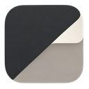
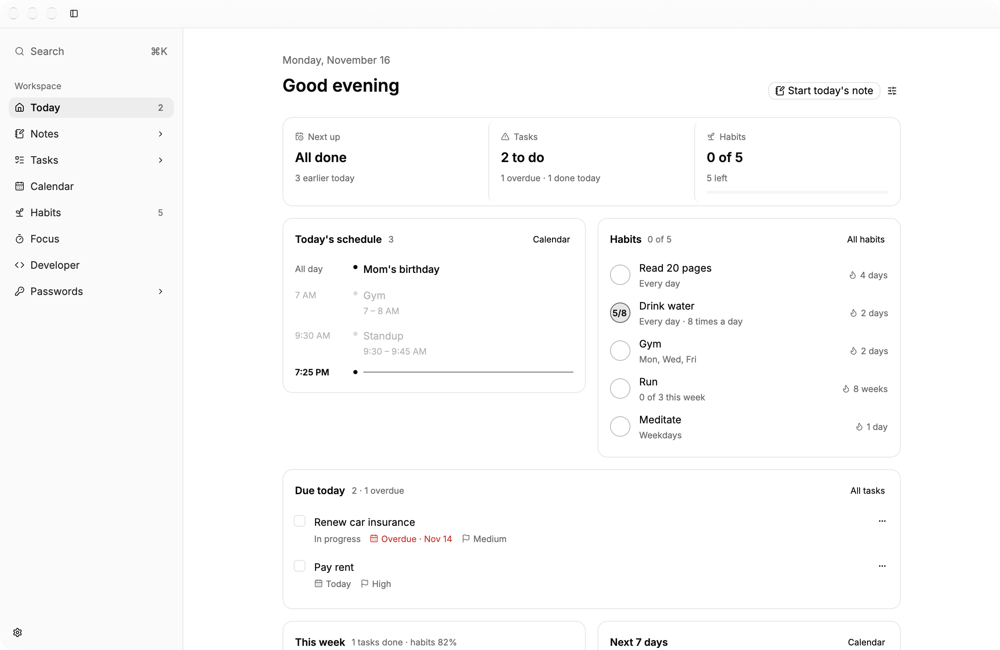

<div align="center">
  
  <h1>Calmfold</h1>
  <p><strong>Your day, in one calm place.</strong></p>
  <p>Notes, tasks, calendar, habits, focus and passwords.<br>Local-first. Native. Made for macOS and Windows.</p>
  <p>
    <a href="https://github.com/MohammedSafwan10/calmfold-releases/releases/latest">Download</a> ·
    <a href="CONTRIBUTING.md">Contribute</a> ·
    <a href="docs/roadmap.md">Roadmap</a> ·
    <a href="LICENSE">GPLv3</a>
  </p>
</div>



Calmfold brings everyday personal tools into one quiet workspace. Your notes and
plans live on your device. There is no required account, cloud subscription or
telemetry. The interface is built in Rust with GPUI Kit.

> **Early release:** v0.1.2 is completing its final release checks. The packages
> below will be available when publication finishes. Previous builds remain
> available in [the source repository's releases](https://github.com/MohammedSafwan10/calmfold/releases).

## Download

Get official builds from [Calmfold Releases](https://github.com/MohammedSafwan10/calmfold-releases/releases/latest).

| Platform | Package |
| --- | --- |
| macOS · Apple Silicon | `Calmfold-<version>-macos-arm64.zip` — extract and move Calmfold.app to Applications |
| Windows · x64 | `Calmfold-win-Setup.exe` — per-user installer |
| Windows · portable | `Calmfold-win-Portable.zip` — extract and keep the complete folder together |

These early builds are not yet Apple-notarized or Windows publisher-signed, so
the OS may warn on first installation. Update signatures are verified separately.

Starting with v0.1.2, installed builds use **Sparkle on Mac** and **Velopack on
Windows**. Install this release once manually; future versions can download in
the background and install from Settings → About. Read the release history inside
the app under **What’s new**.

## One workspace, your way

| Tool | What it does |
| --- | --- |
| **Today** | Your schedule, due tasks, habits and upcoming days, with sections you can arrange or hide |
| **Notes** | Live Markdown, wiki links and backlinks, tags, full-text search, math and diagrams |
| **Tasks** | Quick add, priorities, repeats, subtasks and projects |
| **Calendar** | Month, week, day and agenda views, recurring events, `.ics` import and offline holidays |
| **Habits** | Flexible schedules, counts, streaks and insights |
| **Focus** | Focus and break timers, linked tasks and session history |
| **Passwords** | An encrypted vault, one-time codes, password generation, recovery keys and encrypted backups |
| **Developer** | Projects, useful links, setup notes, tasks and encrypted environment sets with `.env` import/export |

Choose your visible sidebar tools, their order and your startup page. Themes,
fonts and keyboard shortcuts help the workspace fit the way you work.

## Local data, clear boundaries

Personal content stays local; release checks contact GitHub. There is no built-in
cross-device sync yet. Notes, tasks and calendar data are **not encrypted by the
app**. The vault uses Argon2id and XChaCha20-Poly1305. Keep a device backup and
store your vault recovery key somewhere safe.

See the [security design](docs/security.md) for the threat model and recovery
limits, or [report a vulnerability privately](SECURITY.md).

## Build and contribute

Rust is pinned in [`rust-toolchain.toml`](rust-toolchain.toml).

- **macOS:** Xcode and its Metal toolchain.
- **Windows:** MSVC Rust, Visual Studio C++ build tools and CMake.

```sh
git clone https://github.com/MohammedSafwan10/calmfold.git
cd calmfold
cargo run
```

The first build can take several minutes. Debug builds use a separate **Calmfold
Dev** data folder; installing a release does not automatically migrate that data.
Use `CALMFOLD_DATA_DIR` with a new throwaway directory for experiments.

Run `scripts/check.sh` before submitting a change (Git Bash on Windows).
The [contribution guide](CONTRIBUTING.md) covers setup, tests and pull requests.

## Project notes

[Architecture](docs/architecture.md) · [Design system](docs/design-system.md) ·
[Testing](docs/testing.md) · [Roadmap](docs/roadmap.md) ·
[Code of Conduct](CODE_OF_CONDUCT.md)

Calmfold’s original source is licensed under **GPL-3.0-only**. Third-party code,
fonts and icons retain their own terms; see [NOTICE](NOTICE) and the bundled
third-party notices. The license does not grant trademark rights or imply
endorsement of a fork.

Made by **Nexdark Labs**.
